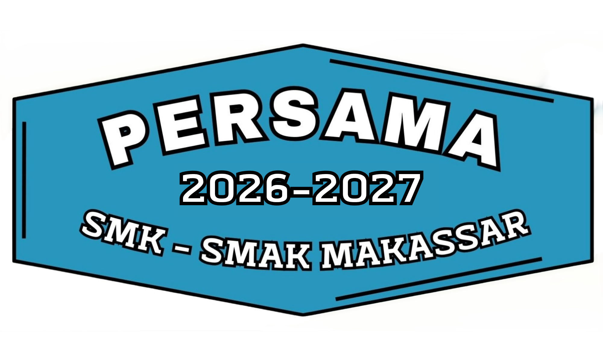

<div align="center">



# PERSAMA

**Ruang digital untuk cerita, karya, dan kepengurusan.**

Situs organisasi PERSAMA · SMK-SMAK Makassar

[](https://persama.my.id)
[](https://nextjs.org/)
[](https://payloadcms.com/)
[](https://www.typescriptlang.org/)

[**Lihat situs**](https://persama.my.id) · [Fitur](#fitur) · [Mulai lokal](#mulai-lokal) · [Konfigurasi](#konfigurasi) · [Kontribusi](#kontribusi)

</div>

---

## Tentang proyek

PERSAMA menyatukan informasi organisasi, struktur kepengurusan, agenda, dokumentasi kegiatan, dan publikasi digital dalam satu situs. Konten dikelola melalui panel admin berbasis Payload CMS, sehingga pembaruan tidak selalu membutuhkan perubahan kode.

Antarmuka menggunakan identitas PERSAMA: hijau **Prestige** `#144647`, merah **Ruby** `#D73445`, dan toska **Hammam** `#65DAD2`, dengan tipografi Poppins dan Plus Jakarta Sans.

## Fitur

### Untuk pengunjung

| Ruang | Isi |
| :--- | :--- |
| **Beranda** | Pengantar organisasi, sorotan kegiatan, dan publikasi |
| **Tentang** | Profil, visi, misi, penanggung jawab, dan pembina |
| **Divisi & pengurus** | Struktur organisasi dan profil kepengurusan berdasarkan periode |
| **Event** | Agenda, detail kegiatan, dan dokumentasi |
| **E-Tabloid** | Publikasi digital PERSAMA |
| **Ekstrakurikuler** | Informasi kegiatan ekstrakurikuler |

### Untuk pengelola

- **Dashboard admin** — ringkasan konten dan akses cepat ke pekerjaan rutin.
- **Kelola konten** — event, tabloid, divisi, pengurus, periode, dan ekstrakurikuler.
- **Pustaka media** — unggah foto dan PDF, termasuk turunan gambar untuk kebutuhan tampilan.
- **Pengaturan situs** — ubah informasi organisasi melalui CMS.
- **Pemantauan penyimpanan** — ukuran database, delapan tabel terbesar, jumlah dokumen, serta ukuran media tercatat.

> Situs publik tidak menyediakan akun pengunjung, pencarian, atau pendaftaran event. Login hanya untuk pengelola melalui `/admin`.

## Teknologi

| Lapisan | Teknologi |
| :--- | :--- |
| Aplikasi | Next.js 16 · React 19 · TypeScript |
| CMS | Payload CMS 3 · Lexical |
| Database | PostgreSQL melalui Supabase |
| Penyimpanan media | Cloudflare R2 melalui API S3 |
| Pengolahan gambar | Sharp |
| Gerak & interaksi | GSAP · Motion · Lenis |
| Hosting | Vercel |

```text
Pengunjung ── Situs Next.js ── Payload CMS ── PostgreSQL
                                  │
Pengelola ── Panel admin ──────────┤
                                  └── Cloudflare R2
```

## Mulai lokal

### Prasyarat

- Node.js **22.23.5 atau lebih baru**, sesuai `engines` di `package.json`.
- npm.
- Database PostgreSQL khusus pengembangan.
- Bucket R2 bila ingin menguji penyimpanan media cloud.

### 1. Ambil sumber dan pasang dependensi

```bash
git clone https://github.com/trexzrex/persama-web.git
cd persama-web
npm ci
```

### 2. Siapkan environment

Salin `.env.example` menjadi `.env`, lalu isi `DATABASE_URI` dan `PAYLOAD_SECRET`. Lihat [konfigurasi](#konfigurasi) untuk variabel lainnya.

> **Keamanan:** gunakan database pengembangan, bukan database produksi. Jangan commit `.env`, kata sandi, token, atau kredensial R2. `PAYLOAD_SECRET` harus berupa nilai acak yang kuat, minimal 32 karakter.

### 3. Jalankan aplikasi

```bash
npm run dev
```

| Tujuan | Alamat |
| :--- | :--- |
| Situs lokal | <http://localhost:3000> |
| Panel admin | <http://localhost:3000/admin> |
| Monitor penyimpanan | <http://localhost:3000/admin/penyimpanan> |

Pada database baru, buka panel admin dan ikuti alur pembuatan pengguna pertama. Pada database yang sudah memiliki pengguna, gunakan akun pengelola yang terdaftar.

Mode pengembangan memakai Webpack melalui skrip proyek.

## Konfigurasi

| Variabel | Kebutuhan | Fungsi |
| :--- | :--- | :--- |
| `DATABASE_URI` | Wajib | Connection string PostgreSQL |
| `PAYLOAD_SECRET` | Wajib | Rahasia untuk autentikasi Payload |
| `NEXT_PUBLIC_SITE_URL` | Sesuaikan lingkungan | Alamat publik situs; gunakan `http://localhost:3000` untuk lokal |
| `R2_BUCKET` | Jika memakai R2 | Nama bucket media |
| `R2_ACCESS_KEY_ID` | Jika memakai R2 | Access key API S3 |
| `R2_SECRET_ACCESS_KEY` | Jika memakai R2 | Secret key API S3 |
| `R2_ENDPOINT` | Jika memakai R2 | Endpoint API S3 Cloudflare R2 |
| `R2_PUBLIC_URL` | Jika memakai R2 | URL publik untuk mengakses berkas media |

Integrasi R2 aktif bila bucket, access key, secret key, dan endpoint terisi. Untuk pengembangan tanpa R2, kosongkan empat variabel tersebut. Untuk deployment dengan media cloud, atur juga URL publik bucket.

<details>
<summary><strong>Cara membaca metrik penyimpanan</strong></summary>

- **Ukuran database** berasal dari `pg_database_size(current_database())`, mencakup database PostgreSQL, bukan hanya dokumen konten.
- **Tabel terbesar** menampilkan maksimal delapan tabel di skema `public`, memakai `pg_total_relation_size` yang mencakup indeks.
- **Ukuran media tercatat** menjumlahkan ukuran berkas asli dan turunan gambar pada koleksi Media.
- Bar database membandingkan ukuran saat ini dengan acuan Free **500 MB**. Ini bukan pembacaan disk atau rata-rata pemakaian organisasi.
- Bar R2 membaca seluruh objek bucket langsung melalui API S3, termasuk berkas yang tidak tercatat di CMS, lalu membandingkannya dengan acuan Standard **10 GB-month** gratis per akun per bulan. Ini bukan batas keras bucket atau laporan tagihan bulanan; bucket lain dan biaya operasi tidak dihitung.
- Waktu pengambilan data ditampilkan dalam **WITA**. Data diperbarui otomatis 15 detik setelah pembacaan selesai saat tab aktif dan online, bukan pembaruan seketika. Tombol jeda menghentikan pembaruan otomatis; **Muat ulang** tetap tersedia.
- Jika bucket gagal dibaca, bar R2 tidak menampilkan nol atau total parsial. Pembacaan dibatasi 10 detik dan maksimal 100 halaman (100.000 objek); bucket lebih besar ditampilkan sebagai tidak tersedia.
- Pembacaan R2 memerlukan izin listing bucket dan menggunakan operasi Class A. Interval pembaruan dan jumlah admin aktif memengaruhi jumlah operasi.
- Halaman hanya membaca data dan membutuhkan login admin.

</details>

## Perintah proyek

| Perintah | Fungsi |
| :--- | :--- |
| `npm run dev` | Jalankan server pengembangan dengan Webpack |
| `npm run build` | Buat build produksi |
| `npm run start` | Jalankan hasil build produksi |
| `npm run lint` | Jalankan ESLint |
| `npx tsc --noEmit` | Periksa tipe TypeScript |
| `npm run generate:types` | Buat ulang tipe dari konfigurasi Payload |
| `npm run generate:importmap` | Buat ulang import map komponen admin |

## Struktur sumber

```text
public/                   Logo, motif, dan aset publik
src/
├── app/
│   ├── (frontend)/        Halaman situs publik
│   └── (payload)/         Panel admin, API, dan tema CMS
├── collections/          Skema koleksi konten
├── components/
│   ├── admin/             Komponen khusus panel pengelola
│   └── site/              Komponen antarmuka publik
├── fields/                Definisi field bersama
├── globals/               Pengaturan global situs
├── lib/                   Akses konten dan fungsi pendukung
└── payload.config.ts      Konfigurasi utama Payload
```

## Deployment

Proyek ditujukan untuk deployment di **Vercel** dengan PostgreSQL dan Cloudflare R2 sebagai layanan terpisah.

1. Hubungkan repository ke proyek Vercel tujuan.
2. Atur environment produksi melalui pengaturan proyek, bukan file yang dipublikasikan.
3. Gunakan koneksi PostgreSQL yang sesuai untuk lingkungan hosting. Contoh konfigurasi tersedia di `.env.example`.
4. Pastikan endpoint R2 dan URL media publik benar jika integrasi diaktifkan.
5. Jalankan pemeriksaan tipe, lint, dan build sebelum merilis perubahan.
6. Setelah deployment, periksa situs publik dan alur admin menggunakan akun berizin.

> **Perubahan skema:** tinjau migrasi database dan siapkan cadangan sebelum menerapkannya ke produksi. Build berhasil tidak membuktikan seluruh alur admin atau aksesibilitas sudah teruji.

## Kontribusi

Perbaikan bug dan usulan peningkatan dapat disampaikan melalui [GitHub Issues](https://github.com/trexzrex/persama-web/issues).

Untuk perubahan kode:

- Pertahankan bahasa Indonesia, identitas visual PERSAMA, dan ketepatan nama serta jabatan pengurus.
- Batasi perubahan pada kebutuhan yang dibahas; hindari perubahan data produksi tanpa persetujuan.
- Periksa tampilan layar kecil, navigasi keyboard, fokus, dan preferensi reduced motion bila mengubah antarmuka.
- Sertakan penjelasan perubahan dan hasil pengujian dalam pull request.
- Jangan sertakan data pribadi, dokumen internal, kredensial, atau hasil ekspor database dalam issue maupun commit.

## Hak penggunaan

Repository ini belum menyertakan lisensi perangkat lunak. Ketersediaan sumber di GitHub tidak otomatis memberikan izin penggunaan ulang. Logo, identitas organisasi, foto, dan konten publikasi tetap mengikuti hak pemilik masing-masing; minta izin sebelum menggunakannya kembali.

---

<div align="center">

**PERSAMA · SMK-SMAK Makassar**

[Kenali organisasi](https://persama.my.id/tentang) · [Kunjungi situs](https://persama.my.id)

</div>
